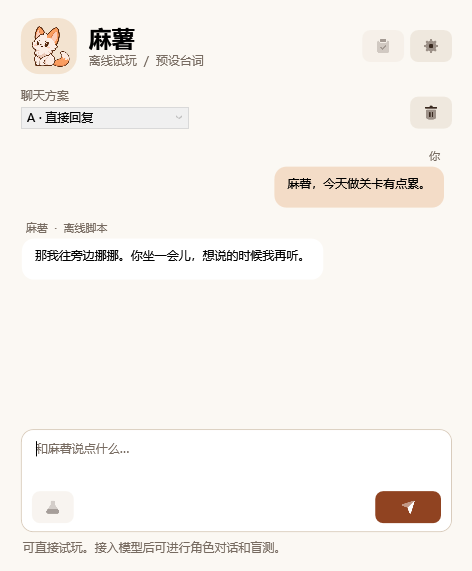

  

<h1 align="center">麻薯 · MochiFox</h1>

一只趴在 Windows 桌角的小狐狸。点一下就能聊天，也能打开 Godot 新手村。

  <strong><a href="https://github.com/Fromlan/Desk-Pet-Releases/releases/latest/download/MochiFox.Desktop-win-x64-Setup.exe">下载 Windows x64 安装包</a></strong>
  · <a href="https://github.com/Fromlan/Desk-Pet-Releases/releases">版本记录</a>

  

## 开始使用

1. 运行下载的 `MochiFox.Desktop-win-x64-Setup.exe`。安装包自带 .NET 运行时。
2. 安装后，**单击**狐狸打开聊天，**按住拖动**可以移动它，**右键**可打开新手村、检查更新或退出。

安装器为未签名构建。发布页面里的 `.nupkg` 和 `releases.win-x64.json` 供程序自动更新使用。

## 麻薯能做什么

- **陪你聊天**。打开即可离线试玩。接入兼容 Chat Completions 的模型后，可使用流式回复、五种对话策略和盲测，也可以编辑麻薯的角色卡和共同手记。
- **浏览 Godot 新手村**。以游客身份阅读公开文章和动态，按分类浏览或搜索文章，也可登录自己的新手村账号。

## 自动更新

安装版启动后在后台检查更新，持续运行时每 6 小时检查一次，失败后 2 分钟重试。也可以右键狐狸选择 **检查更新**。

下载完成后，选择立即重启即可安装。想稍后处理时，可从右键菜单选择 **重启以更新**。聊天记录、角色设置和登录凭据保存在 Windows 用户目录 `%LOCALAPPDATA%\MochiFox`，升级后继续使用。

## 反馈

反馈时请附上麻薯版本、Windows 版本和复现步骤，便于定位问题。[提交问题](https://github.com/Fromlan/Desk-Pet-Releases/issues/new)
